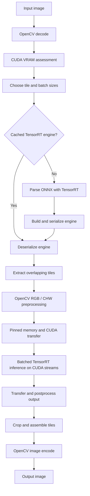

# TexUpSR

**GPU-Accelerated Super-Resolution Upscaler using TensorRT and ONNX**

TexUpSR is a C++17 command-line image upscaler that parses ONNX super-resolution models with NVIDIA TensorRT, builds or loads a serialized TensorRT engine, and processes images using CUDA streams and tiled inference. OpenCV handles image input, preprocessing, compositing, and output.

> **Platform status:** Currently tested only on Windows. Other platforms are not verified. An NVIDIA CUDA-capable GPU is required.

## Features

- Direct TensorRT C++ API and TensorRT ONNX parser integration (**no ONNX Runtime dependency**).
- Conservative automatic tile and batch selection based on available GPU memory.
- Multiple CUDA streams, per-stream TensorRT contexts, reusable device allocations, and pinned host buffers.
- Overlapping input tiles with weighted feather blending of their output regions.
- TensorRT engine serialization and reuse; optional user-specified engine path.
- Configurable scale, workspace size, streams, tile size, batch size, and overlap.

## Dependencies

| Dependency | Purpose | Download / documentation |
| --- | --- | --- |
| Windows 11 (tested environment) | Build and runtime OS | [Microsoft Windows](https://www.microsoft.com/windows) |
| NVIDIA GPU and compatible driver | CUDA/TensorRT inference | [NVIDIA drivers](https://www.nvidia.com/Download/index.aspx) |
| CUDA Toolkit **13.0** (configured path) | CUDA headers, runtime, libraries | [NVIDIA CUDA Toolkit](https://developer.nvidia.com/cuda-toolkit) |
| TensorRT **10.13.3.9** (configured path) | Inference engine and ONNX parser | [NVIDIA TensorRT](https://developer.nvidia.com/tensorrt) |
| OpenCV **4.12.0** (observed build) | Image decoding, processing, output | [OpenCV releases](https://opencv.org/releases/) |
| CMake **3.20+** (declared minimum) | C++ project configuration and build | [CMake downloads](https://cmake.org/download/) |
| Visual Studio 2022 with Desktop development with C++ | MSVC compiler, Windows SDK, MSBuild | [Visual Studio downloads](https://visualstudio.microsoft.com/downloads/) |
| C++17 compiler | Required language standard | Included with Visual Studio |
| ONNX super-resolution model | Model input at runtime; must be compatible with TensorRT and the program's expected tensor layout | [ONNX models](https://github.com/onnx/models) |

TensorRT and CUDA versions must be mutually compatible with each other, the installed GPU driver, and the target GPU. The versions above reflect the provided configuration, **not a claim that all other versions are supported**. OpenCV must include its development headers and libraries. Python, Node.js, npm, and ONNX Runtime are not required to compile this standalone C++ component.

## Configure dependencies

The `CMakeLists.txt` provides machine-specific default paths. Override them at configuration time or edit the defaults:

```cmake
set(TensorRT_ROOT "E:/Projects/TensorRT-10.13.3.9" CACHE PATH "TensorRT installation directory")
set(OpenCV_DIR "C:/opencv/build" CACHE PATH "Path to OpenCV")
```

Point each value at your installation. The CMake file also links `nvinfer_10.lib`, `nvonnxparser_10.lib`, and `cudart.lib`, and searches for OpenCV DLLs under `x64/vc16/bin`. Verify those paths and filenames for your installed versions. The build copies selected dependency DLLs beside the executable; installing TensorRT separately remains necessary for building, and its redistribution terms must be respected.

## Build on Windows (command line)

From the directory containing `CMakeLists.txt` and `main.cpp` (the provided project uses `src/upscaler`):

```powershell
cmake -S . -B build -G "Visual Studio 17 2022" -A x64
cmake --build build --config Release -- /m
```

The Visual Studio executable is generated at `build/Release/trt_sr.exe`. The CMake file copies dependency DLLs beside the built executable; it does not copy the executable to a separate distribution folder.

The standalone snapshot does not require Go Task or a parent repository.

## Usage

```powershell
.\build\Release\trt_sr.exe -i input.png -o output.png -m model.onnx
```

Explicit tiling and batch size:

```powershell
.\build\Release\trt_sr.exe -i input.png -o output.png -m model.onnx -t 256 -b 4
```

Additional settings:

```powershell
.\build\Release\trt_sr.exe -i input.png -o output.png -m model.onnx -s 4 --streams 2 --overlap 16 -w 4
```

| Option | Description | Default |
| --- | --- | --- |
| `-i`, `--input` | Input image path (required) | — |
| `-o`, `--output` | Output image path (required) | — |
| `-m`, `--model` | ONNX model path (required) | — |
| `-e`, `--engine` | Existing or output TensorRT engine path | Automatically generated in `engines/` |
| `-t`, `--tile` | Tile size; `0` or `-1` for automatic selection | Auto |
| `-b`, `--batch` | Batch size; `0` or `-1` for automatic selection | Auto |
| `-s`, `--scale` | Upscaling factor | `4` |
| `-w`, `--workspace` | TensorRT workspace limit in GiB | `4` |
| `--streams` | Number of CUDA streams | `2` |
| `--overlap` | Overlap in source-image pixels | `16` |
| `-v`, `--verbose` | Verbose TensorRT logging | Off |
| `-q`, `--quiet` | Suppress progress output | Off |
| `-d`, `--debug` | Write a diagnostic tile image | Off |
| `-h`, `--help` | Display command-line help | — |

The code expects an ONNX super-resolution network with compatible RGB, three-channel tensor shapes and floating-point data. The requested `--scale` must match the model's actual output scaling; not every ONNX model will work. Engine files are hardware/software-version-sensitive and may need rebuilding after GPU, driver, TensorRT, or model changes. Automatically named engine files include model basename, tile size, and batch size; they do not encode every compatibility factor. The implementation performs true batched inference, padding the final partial batch to the configured engine batch size.

## Processing architecture



## Troubleshooting

| Problem | What to check |
| --- | --- |
| CMake cannot find CUDA | Confirm CUDA Toolkit installation and pass `-DCUDAToolkit_ROOT="C:/Program Files/NVIDIA GPU Computing Toolkit/CUDA/v13.0"`. This project uses modern `find_package(CUDAToolkit REQUIRED)`. |
| Missing `NvInfer.h` or `NvOnnxParser.h` | Verify `TensorRT_ROOT/include` and the TensorRT developer package. |
| Missing `.lib` files or linker errors | Verify the TensorRT and CUDA library filenames, MSVC architecture, and installed versions. |
| OpenCV not found | Set `OpenCV_DIR` to the directory containing the correct OpenCV CMake package configuration. |
| Missing DLL at runtime | Ensure compatible TensorRT, CUDA runtime, and OpenCV DLLs are available beside the executable or on `PATH`. |
| TensorRT rejects ONNX model | Check operator support, tensor shapes, input/output format, and TensorRT compatibility. |
| Engine fails to deserialize | Remove the incompatible cached `.plan` file and rebuild from the ONNX model. |
| CUDA out of memory | Reduce `--tile`, `--batch`, `--streams`, or `--workspace` as appropriate. |
| Unexpected image size or artifacts | Ensure `--scale` matches the model and review tile overlap and model color conventions. |

## License and attribution

Copyright (c) 2025 Elden Armbrust.

TexUpSR is licensed under the **MIT License**. See [LICENSE](LICENSE) for the complete license text. The MIT License permits use, modification, and redistribution, provided the copyright notice and permission notice are included in copies or substantial portions of the software. It provides the software **AS IS**, disclaims warranties, and limits author/copyright-holder liability to the extent permitted by applicable law. This includes risks associated with software operation and generated output, but no license can guarantee protection against every conceivable claim.

TensorRT, CUDA, OpenCV, third-party models, and other dependencies remain subject to their own licenses and distribution terms. Users are responsible for ensuring that their models, input images, outputs, and uses comply with applicable laws and third-party rights.
